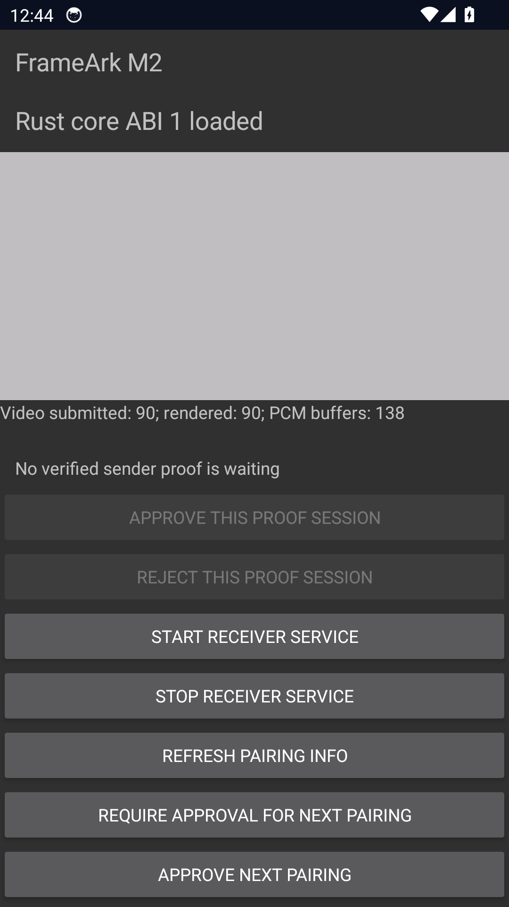

# Android Native playback — 2026-10-13

Environment: developer-owned disposable Android 14 / API 34 Google APIs x86_64
AVD on Windows, SwiftShader, no host audio output. This is **not** an owner
physical-device result. The user retains their own devices and runs delivered
APKs themselves. No remote-device/ADB permission was requested or used.

## Method

`NativePlaybackTest` starts the real Activity/Surface, Keystore-backed service
and Rust listener. Android encoders generate an Annex-B 320×240 gray H.264 IDR
with SPS/PPS and a silent 48 kHz stereo AAC-LC access unit. An explicitly
test-feature-gated JNI sender repeats those AUs with paced timestamps over
pinned loopback QUIC and the real FANP Offer/Start/media/Stop sequence. Receiver
output uses `c2.goldfish.h264.decoder`, `c2.android.aac.decoder` and AudioTrack.
The synthetic repeated IDR/silence is not a camera/screen capture workload.

Assertions require at least 80 frame-rendered callbacks, 100 complete PCM
buffer writes, both codecs released after ordered Stop, and listener stopped
after service teardown. See the [receiver README](../../../apps/android/receiver/README.md)
for build/run commands. Instrumentation is compiled by CI; runtime evidence here
is local and is not implied by CI's JVM test result.

## Observations

Three consecutive runs after the queue-budget fix passed:

| Run | Video submitted | Frame-rendered callbacks | Complete PCM buffer writes |
|---|---:|---:|---:|
| 1 | 90 | 90 | 130 |
| 2 | 90 | 90 | 126 |
| 3 | 90 | 90 | 131 |
| Final teardown-wait regression rerun | 90 | 90 | 138 |

Earlier runs exposed initial network callback restarts, immediate failure on
zero/partial PCM writes, and overflow of the 32-event queue during cold decoder
setup/short stalls. Fixes filter default Network identity, retain bounded PCM
partial writes, and use 128 events while retaining the 16 MiB byte cap. Saturated
queues still fail the session explicitly. This does not establish low latency.

The screenshot contains no PIN, certificate, real media or peer identifier. The
gray rectangle is the encoded sample's actual decoded output, not a UI mockup.

Local Rust workspace tests and Clippy (`--all-features --locked`), 81 Kotlin
unit tests and Android lint pass. Coverage includes queue bounds/future-clock
rejection, time-base conversion, malformed FAPE, config/frame/reset ordering,
in-flight stop, PCM partial writes/capacity/reset, and initial network identity.

## Limits

PCM counts mean accepted complete writes to AudioTrack, not audible verification;
pending PCM/decoder tail is discarded on Stop. No hardware-device, Opus output,
LAN discovery, loss/recovery soak, real capture, 1080p30/60, long-run clock drift,
lip-sync or one-hour claim follows. M1/M2 remain Partial. Test-feature JNI and
instrumentation APKs are not production/owner delivery artifacts.
