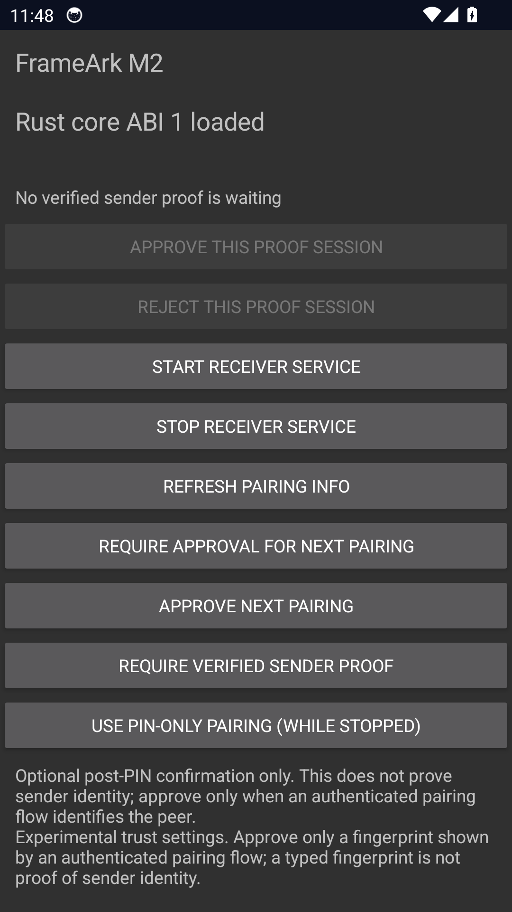

# Android proof approval shell smoke — 2026-10-13

Environment: Windows host, disposable Android 14 / API 34 Google APIs x86_64
emulator, 1080×1920 at 420dpi. Rust 1.97 built `frameark-ffi` with NDK
28.0.12433566 for `x86_64-linux-android`; the debug APK packaged that library
using an ignored local Gradle init script. Production ABI filters are unchanged.

Observed against the changes in ADRs 0116 and 0117:

- APK installation and cold Activity launch succeeded; the screen reported
  `Rust core ABI 1 loaded` (not the unavailable-library fallback).
- No pending request: both session decision buttons were disabled.
- While stopped, selecting verified proof mode succeeded through JNI.
- Starting the foreground receiver produced its local FANP endpoint.
- Selecting PIN-only mode while running was rejected by Rust and reported in
  the UI. Stopping restored the idle screen and removed the pairing display.
- The emulator was stopped after the smoke test.

The screenshot intentionally contains no PIN, peer identity or fingerprint.
This is **not** an incoming-sender UI integration test: pending approval,
expiry, rejection and pause are covered by JVM coordinator tests, while real
pinned-QUIC delayed approval/cancellation is covered separately by Rust tests.
The 72 JVM tests and Android lint passed locally. No physical ARM device,
hardware decoder, media output, accessibility audit or playback-duration claim
is made. M1/M2 exit gates remain open.
