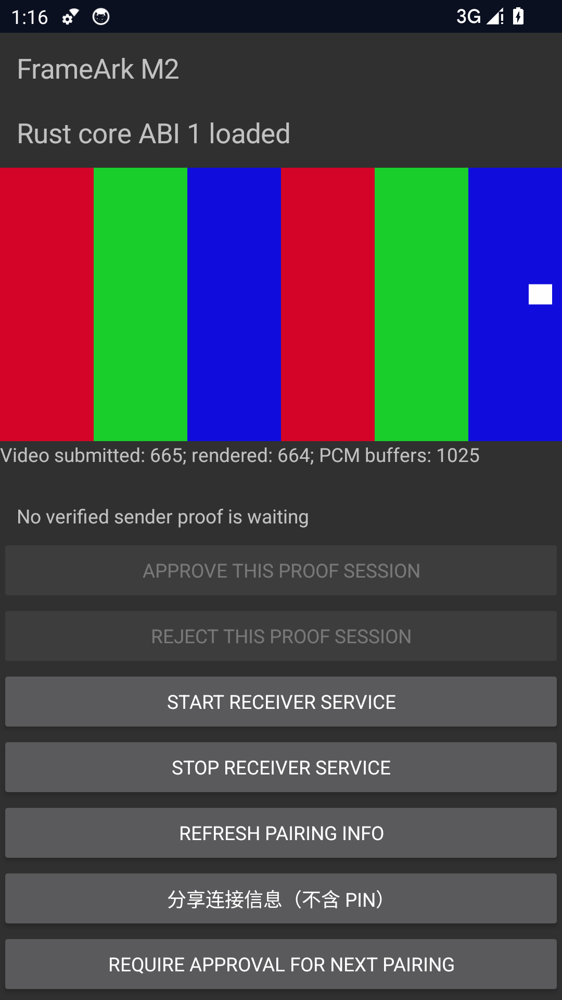
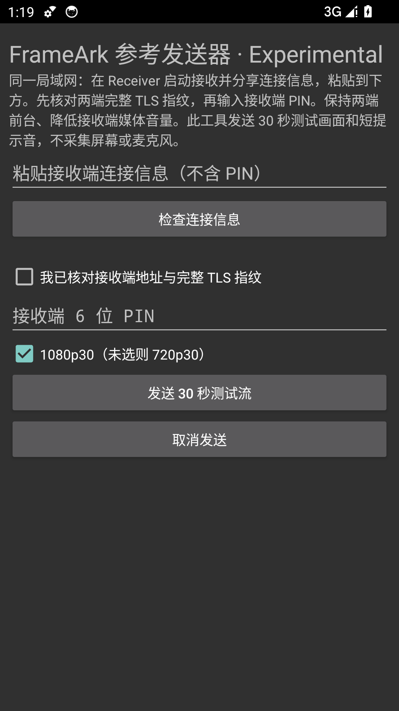

# Android reference Sender — 2026-10-13

Developer-owned disposable API 34 Google APIs x86_64 emulators on Windows,
SwiftShader, no audible host output. Receiver and Sender are separate APKs and
processes in **two emulators**, linked through host UDP forwarding. This is not
a user's phone, physical LAN discovery, hardware-decoder or Apple result.

## Exercised path

Actual EGL moving pattern → Android H.264 baseline encoder, generated 48 kHz
stereo tone → AAC-LC encoder → Sender JNI → Rust pinned QUIC/PIN/Offer/Start
→ FAM1 → Receiver JNI FAPE pacing → MediaCodec/TextureView and AudioTrack →
Finish/Stop and codec/listener teardown. Both use the production sender path,
not the earlier repeated-IDR playback probe. Instrumentation only arranges
temporary credentials and asserts counters/cleanup. Sender uses explicit
microsecond encoder timestamps. No DRM, personal capture or third-party stream.

Each stream is 30 seconds, 1920×1080 at 30 fps. The bridge-driven run produced
900 video frames and 1405 AAC packets; Receiver rendered 900 frames and
completed 1403 PCM buffer writes. Normal Stop passed at both ends.

The full Sender UI path then completed three consecutive runs, including
ticket inspect, exact-ticket confirmation, separate PIN and Send button:

| UI run | Video submitted | Video rendered | Complete PCM buffers | End/teardown |
|---|---:|---:|---:|---|
| 1 | 900 | 900 | 1403 | Passed |
| 2 | 900 | 900 | 1403 | Passed |
| 3 | 900 | 900 | 1402 | Passed |

Encoder cancellation at the fifth 720p video frame followed by a fresh
one-second encode passed (30 frames on the next run). Negative unit tests
exercise PIN rejection, cancellable setup, exact ticket confirmation, unsafe
addresses/versions/hex, bounded queue bytes/count and post-Finish/Cancel refusal.
The idle Receiver surface-destroy/recreate test also passed: the exact ticket
remained valid while idle, and explicit service teardown released the listener.

Screenshots were inspected: no PIN, address, certificate, fingerprint or user
media appears. Sender's secure screenshot flag was temporarily cleared only
by instrumentation for the **blank form**, then restored before input. The
Receiver snapshot is from the bridge-driven run during actual playback.

## Failures retained and limits

The first two-emulator attempt timed out before pairing and rendered zero
frames. The virtual Wi-Fi route conflicted with the receiver emulator's host
UDP-forwarding path; rerunning with virtual Wi-Fi disabled and emulated
Ethernet available succeeded. No product encryption/network policy was relaxed.
An initial UI-harness run also timed out without a captured sender-stage detail;
its specific cause is unproven. The harness now reports only redacted status
and fails early on explicit errors; the three consecutive UI runs above passed.
These earlier failures are not counted as passes or silently omitted.

Normal ARM64 debug and unsigned release APK builds, native-package checks,
Android lint and 83 JVM tests, 198 Rust tests/Clippy/formatting and documentation
builds are separate from the emulator runtime. CI compiles instrumentation,
but does not automatically reproduce these local emulator observations.

No audible quality, measured A/V skew/latency, physical Wi-Fi, hardware codec,
packet loss/recovery, rotation, real screen capture, Opus, sustained one-hour,
1080p60 or M1/M2 exit claim follows. PCM tail may be discarded on Stop.
Owner validation uses the [two-APK instructions](../../testing/ANDROID_REFERENCE_SENDER.md).
