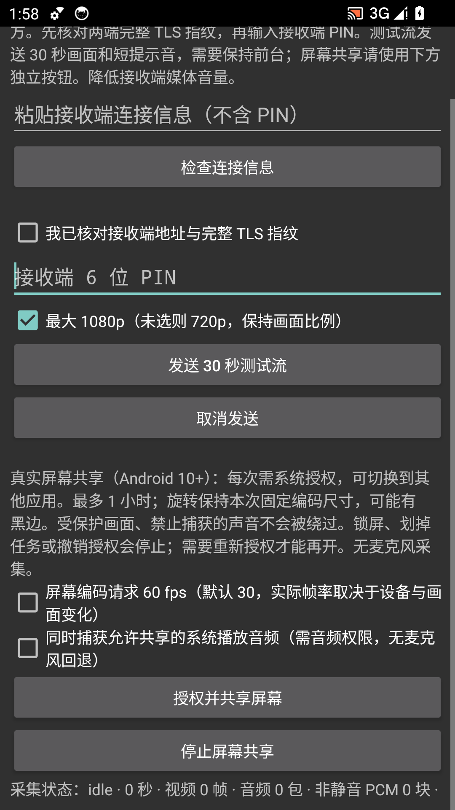
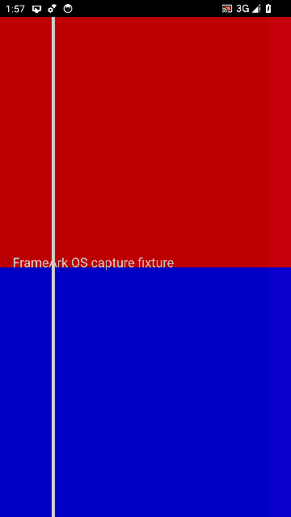

# Real Android OS capture — 2026-10-13

Developer-owned disposable API 34 Google APIs x86_64 emulators, Windows host,
SwiftShader, separate Sender/Receiver APKs/processes and host UDP forwarding.
No owner hardware, private media, microphone, audible-quality or Apple test.

## Actual path

Sender ticket inspection/confirmation/PIN → Android system consent → non-exported
MediaProjection foreground service → actual changing display and optional
AudioTrack playback captured by AudioPlaybackCapture → surface H.264 and AAC-LC
MediaCodec encoders → JNI → Rust pinned QUIC/FANP → Receiver FAPE pacing →
MediaCodec/TextureView pixel verification and AudioTrack PCM writes → Stop and
codec/service release. No PROJECT_MEDIA permission bypass or synthetic encoded
payload injection. The explicitly enabled debug fixture draws red/blue regions
and plays a tone; it is absent from owner APKs.

Capture canvas is 1080×1920, **60 fps requested, not achieved/claimed**. Each run
lasts about 25 seconds. The emulator delivers roughly 24–28 fps, not a hardware
1080p60 Beta result. Snapshot counts can precede final queued frame drain.

| Run | Sender snapshot video / AAC / non-silent PCM | Receiver rendered / PCM | Result |
|---|---|---|---|
| Audio 1 | 604 / 1167 / 1150 | 605 / 1165 | Red/blue decoded pixels, user Stop, release passed |
| Video only + screen lock | 678 / 0 / 0 | 695 / 0 | Red/blue pixels, no unrequested audio, lock stops capture |
| Audio after lock/restart | 653 / 1162 / 1152 | 653 / 1162 | Fresh consent, pixels, playback capture and release passed |
| Deny, then explicitly authorize | 574 / 1141 / 1133 | 575 / 1141 | OS Cancel starts nothing; fresh grant, pixels, Stop and service removal passed |

The reference UI mode was also rerun: 900/900 video frames and 1401 receiver PCM
writes, with normal end and decoder release. The empty capture UI was rendered
and inspected; screenshots below contain no connection material.

JVM tests cover geometry/bounds, redaction, single-use/expired handoff and stale
service diagnostics. Native tests keep reference/capture duration policies
separate, reject absent-track audio and oversized/invalid PTS/payloads, and retain
wrong-PIN/cancellation/queue tests. The full Rust workspace passed 199 tests,
Clippy, formatting and warning-denying rustdoc. Android lint, JVM tests, both
normal ARM64 debug/unsigned-release builds and native packaging checks passed;
opt-in instrumentation fixture compilation passed separately. CI verification
accompanies the implementing PR; no milestone exit has been marked complete.

Follow [reproduction instructions](../../testing/ANDROID_SCREEN_CAPTURE.md).
Remaining: named physical devices, actual 60 fps/one-hour metrics, audible and
calibrated A/V sync, rotation/reconfiguration, reconnect, all vendor/OS versions.
