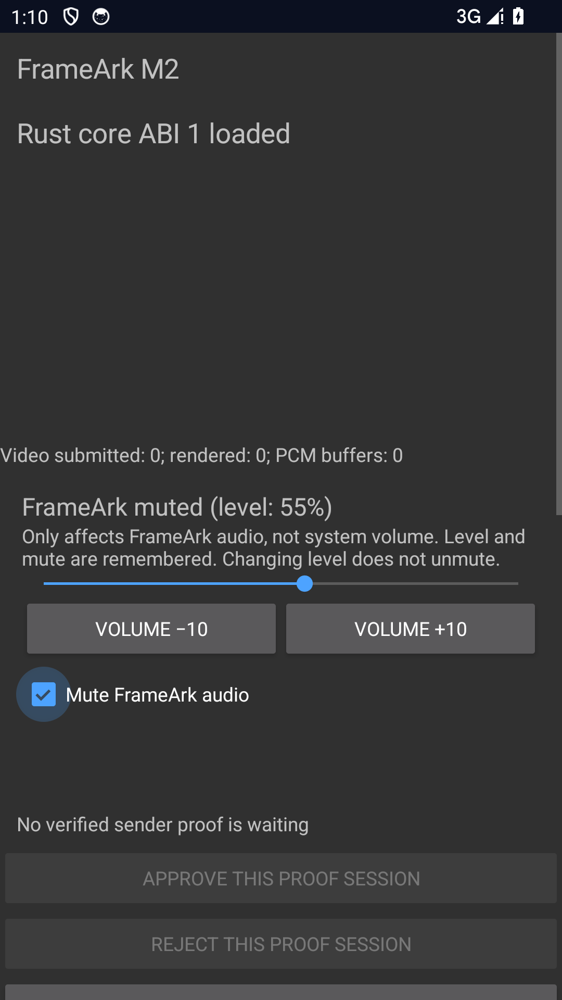

# Receiver-local audio controls — 2026-10-14

Branch: `feat/android-receiver-audio-controls`. Scope: M2 local audio output,
not network remote control, system volume or a completed milestone.
See [decision](../../adr/0127-receiver-local-audio-controls.md) and
[owner checklist](../../testing/ANDROID_AUDIO_CONTROLS.md).

## Automated checks

- 103 Receiver/Sender JVM tests pass, including nine new level/output tests:
  all integer levels, invalid/overflow values, separate mute, gain-before-play,
  reset retention, live updates without restart, 100 consumed muted PCM buffers,
  initial/live/play/release failures and exactly-once release ownership.
- Both debug Lint tasks pass. Existing warnings remain; new programmatic-panel
  constructor and deliberate synchronous preference-write warnings are not
  globally suppressed. No XML inflation uses the injected panel constructor.
- Rust workspace all-feature tests: 214 passed, one opt-in live-mDNS test ignored.
  Formatting, all-target/all-feature Clippy with warnings denied, and rustdoc
  with warnings denied pass. No Rust source/ABI/wire/dependency changes.
- Python repository/release unit tests: 22 passed.

## Isolated Android evidence

Agent-owned `frameark_proof_ui`, API 34 x86_64, port 5582. No owner's phone,
TV or existing emulator used. No production signing material. Agent emulator
stopped after testing.

`ReceiverAudioControlsTest`: **4 passed, 3.483 seconds**.

- Real production AudioTrack adapter accepts zero/0.25/unity/zero gain while
  configured; four PCM buffers are written. Reconfiguration to mono remains
  valid. System STREAM_MUSIC volume is unchanged, and reset releases output.
- Actual D-pad center/right input changes button/slider/checkbox state from
  40 muted → 50 muted → 55 muted → 55 unmuted. Explicit mute is persisted.
  A new settings reader sees it; output reset and later initialization do not
  replace live state. This is not a physical cold-boot durability result.
- Wrong preference type and out-of-range value restore zero/muted.
- Injected panel callback failures show unsaved/output-failure messages and
  preserve current/safe-muted state. This does not simulate physical disk or
  AudioTrack hardware failure; output exceptions are tested with JVM fakes.

`NativePlaybackTest`: **1 passed, 6.331 seconds**. Platform-encoded 320×240
H.264 and silent stereo AAC flow through pinned QUIC → Rust/JNI → MediaCodec →
TextureView/AudioTrack. During one live stream, actual UI actions mute at 50%,
raise to 60% while still muted, and explicitly unmute. At least ten further
PCM callbacks are required between each action; no output reset is allowed.
Observed **90 rendered video frames / 128 completed PCM buffers**. Stop releases
both outputs and retains the selected level. The test-only native probe feature
is confined to the instrumentation build and must not ship in preview APKs.

The idle [screenshot](audio-controls.png) was visually checked: controls and
muted status are readable, with no PIN, endpoint, identity or private media.
It is the English locale; Chinese resources pass Android resource/Lint checks.

## Limits

The sample contains silence and the emulator has no audible output enabled.
The result proves control propagation, API acceptance, continued decode/write
and cleanup, **not audible gain, mute latency or loudness**. No physical phone/TV,
Bluetooth/HDMI, 1080p60 one-hour, lip-sync, rotation, address migration, Apple,
DLNA/RAOP volume mapping or sender remote-control acceptance is claimed.
