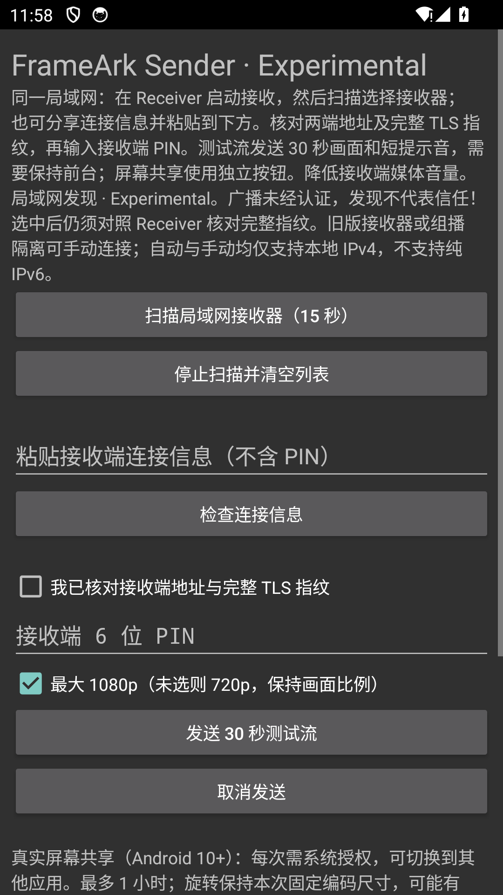

# Sender discovery evidence — 2026-10-14

Scope: [ADR 0124](../../adr/0124-android-sender-discovery.md), Experimental M1
discovery/select/explicit-approval path. No M0–M5 exit gate is closed here.

## Executed checks

- Windows host: Rust 1.97.0, `cargo fmt --all -- --check`, workspace Clippy with
  all targets/features and `-D warnings`, workspace tests with all features/locked.
- Six discovery unit cases include 2048 deterministic arbitrary-byte/length TXT
  mutations, total TXT/collection/certificate limits, version/downgrade rejection,
  case handling, local-address filtering, cache expiry/removal/replacement/capacity.
  FFI test checks cancellation, worker join and stale generation matching.
- Explicit `cargo test -p frameark-native --test discovery_lan --locked -- --ignored`
  passed twice on the host (about one second each): two real mDNS daemons,
  advertisement-to-candidate certificate equality, private-IPv4 QUIC/PIN,
  1080p30 Offer, Start, Streaming query, Stop and backend reset, then unregister
  and both daemon shutdowns. This backend records lifecycle, **not decoded media**.
- Android Java 21, SDK 36, NDK 28.0.12433566: both apps' Lint and 90 JVM tests
  passed, plus debug/release APK and instrumentation builds. Normal ARM64 JNI
  was verified inside both APKs. Shared native code also built for x86_64.
- Third-party generation verified 123 components/255 original legal files and
  both resolved JVM runtime inventories. Actual two-APK temporary-key signing,
  certificate pinning/alignment, missing-notice rejection and wrong-certificate/
  password/missing-secret cleanup smoke passed. The disposable key was removed
  by the smoke test; no production signing key or public release was created.

## Android runtime evidence

Ran the two instrumentation classes concurrently in separate app processes on
one **agent-owned disposable API 34 x86_64 emulator** (`emulator-5582`), twice:

1. `dev.frameark.receiver.DiscoveryReceiverTest#testAdvertisesForSender` starts
   the actual Receiver service, publishes its public ephemeral certificate and
   keeps the idle listener alive while Sender becomes foreground. No ticket/PIN
   is exported to fixture files. Normal service-stop cleanup is asserted.
2. `dev.frameark.sender.DiscoverySenderTest#testSelectionRequiresFreshConfirmationAndPin`
   presses the real scan button and receives an actual multicast candidate.
   It first sets a deliberately different inspected ticket, confirmation and
   fixture PIN, then selects the discovered candidate. The real form clears old
   confirmation/PIN, displays the full TLS fingerprint, rejects Send without
   renewed approval/PIN, and clears candidates when scanning is cancelled.

Both runs: `OK (1 test)` from each app. This proves real Android mDNS/JNI/UI
selection, not two-device Wi-Fi routing, TLS fingerprint human judgment,
video playback, performance or physical hardware. The separate Windows test
proves candidate-to-QUIC control flow. These distinct tests must not be
represented as one physical end-to-end playback test.

Reproduction after building matching x86_64 app/instrumentation APKs: install
only into an explicitly designated disposable emulator; run Receiver with
`adb -s <test-emulator> shell am instrument -w -r -e class
dev.frameark.receiver.DiscoveryReceiverTest#testAdvertisesForSender
dev.frameark.receiver.test/android.test.InstrumentationTestRunner`; once the
credential-free `discovery=ready` status appears, run the corresponding Sender
class with its `dev.frameark.sender.test/android.test.InstrumentationTestRunner`
in a second terminal. Receiver's bounded fixture lifetime is 40 seconds.
Do not run these fixtures on user devices or ship instrumentation APKs.

Screenshot taken before scanning or entering credentials. Instrumentation
temporarily removes FLAG_SECURE only for this empty screen, restores it before
scanning, and never captures candidate endpoints, fingerprints or PINs.

## Still open

Owner-operated two-device discovery → verified authorization → 1080p30 playback
→ teardown/repeat, multicast-restricted Wi-Fi/mesh/router coverage, IPv6, QR,
proof-capable Sender, hostile-LAN backend-cache stress, measured 1080p60,
one-hour stability and recovery. Follow the [operator guide](../../testing/ANDROID_REFERENCE_SENDER.md);
do not return PINs, tickets, addresses, fingerprints or personal media.
