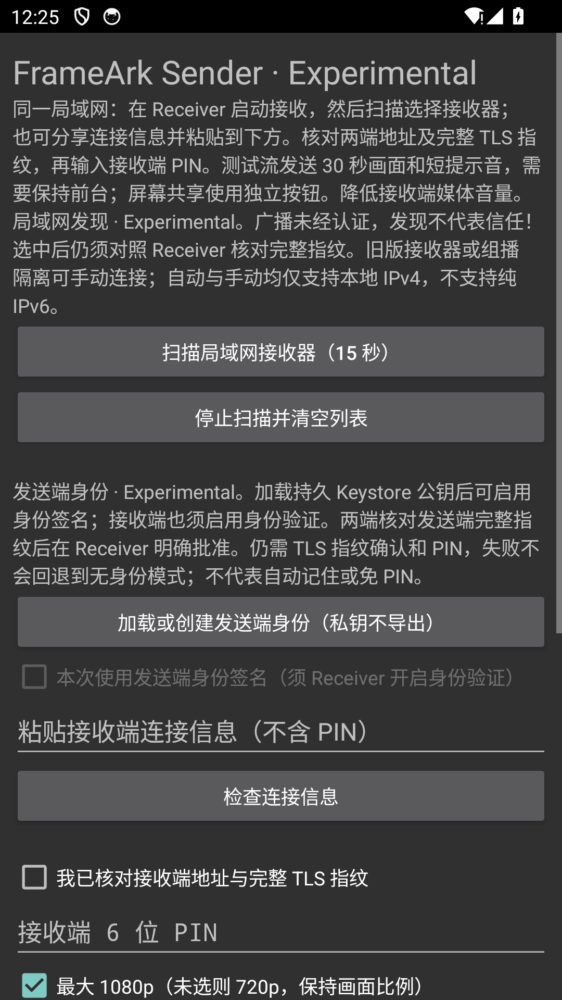

# Android Sender identity evidence — 2026-10-14

Scope: ADR 0125, Experimental P-256 proof and opt-in Android Keystore identity.
Not physical-device, hardware-security, two-device LAN or M2 exit acceptance.

## Local verification

- Windows: Rust workspace `cargo test --workspace --all-features --locked`:
  211 passed; one opt-in live-mDNS test ignored (not rerun for this identity unit).
- `cargo clippy --workspace --all-targets --all-features --locked -- -D warnings`,
  `cargo fmt --all -- --check`, warning-denying workspace rustdoc.
- Python automation regression: 22 tests passed.
- Android Sender/Receiver: 92 JVM tests passed and debug lint; ARM64 and x86_64 release
  JNI builds. No new dependency/lockfile or production signing changes.

## Disposable Android evidence

Agent-owned `frameark_proof_ui`, emulator-5582, API 34 x86_64, Windows WHPX.
The owner's emulator-5554 and physical devices were not used. Normal Rust
library built without playback-probe features; Gradle's test configuration
selects x86_64. These instrumentation/probe APKs are **not** delivery artifacts.

`SenderIdentityTest#testKeystoreProofApprovalRejectionAndTrustedReconnect`
passed with real Android Keystore P-256, unchanged public key across loads,
private-key encoding null, JNI signing request/reply and real pinned QUIC.
The receiver-side fixture binds existing production JNI exports within the
same test process; it is not a second Receiver app/UI. It checks canonical
fingerprint agreement, proof-required approval, denial/cancellation, explicit
stopped-state trust enrollment, fresh proof reconnect with no prompt, and
revoke/restart requiring approval again. The final rerun also checks a six-second
human approval delay and the 60 fps/video-only capture handshake configuration
(not a MediaProjection grant or captured-media test). Late/stale signatures are rejected.
No PIN, ticket, public fingerprint or key is logged or stored in fixture files.

`SenderIdentityUiTest#testExplicitOptInClearsPinAndConfirmation` passed:
identity starts unloaded/disabled/unchecked, load stays unchecked, Rust's
summary appears, and both opt-in/opt-out clear old PIN and TLS confirmation.
Screenshot was taken only on the empty form before loading a key or discovering
a peer. It contains no credentials or persistent identity.

Screenshot SHA-256:
`9b78a279be062f75e8cfe0eca7ecf67b24d22e599a80f5cec687c8b7d1c558d9`.

## Remaining evidence

Receiver UI with a real Sender on separate physical devices, named Android
Keystore implementations/reboot persistence, screen-capture media under proof,
hardware 1080p60/one-hour stability, interrupted-network recovery, and live
trust revocation remain unverified. Production signing remains owner-controlled
through the protected environment. No milestone is marked complete.
