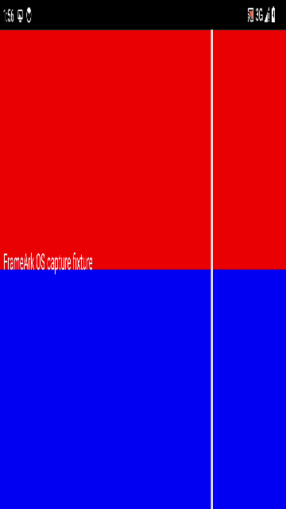

# Native video reconfiguration — 2026-10-14

Branch: `feat/native-video-reconfiguration`. Scope: M2 dynamic geometry and
foreground output continuity, not a completed milestone. See
[ADR 0128](../../adr/0128-native-video-reconfiguration.md),
[wire specification](../../protocols/fanp/README.md) and
[operator checklist](../../testing/ANDROID_SCREEN_CAPTURE.md).

## Verification

- Rust Native: 27 unit tests plus three real-QUIC network-continuity tests.
  New tests cover opcode round trips/legacy bytes, every truncation, malformed
  fields, three ordered updates with continuous video/audio PTS, unchanged audio
  configuration and no intermediate reset, unsupported negotiation, unnegotiated
  update, replay, receiver policy, 256-update cap, missing keyframe, backend and
  renderer failure, timeout and task cancellation cleanup.
- FFI: 34 unit tests. Added command-queue order/backpressure/capture-only gates,
  finish/cancel rejection and video-config preservation of both playback clocks.
- Android JVM: 107 tests pass, including resize coalescing/bounds/preset retention
  and aspect-fit geometry tests. Both debug Lint tasks pass with existing warnings.
- Python repository/release unit tests: 22 pass. No dependency/license change.
- Full Rust workspace: 225 pass; one opt-in live-mDNS test is intentionally
  ignored (not rerun on a physical LAN). Formatting, all-target/all-feature
  Clippy and rustdoc with warnings denied pass.

## Actual OS capture and output

Only agent-owned API 34 x86_64 emulators `frameark_proof_ui` and
`frameark_resize_sender` were used, with explicit temporary host UDP forwarding.
No owner's phone/TV/emulator was operated. The isolated fixture draws a changing
red/blue screen and plays permitted AudioTrack PCM; real MediaProjection and
AudioPlaybackCapture feed H.264/AAC → production Native QUIC → Rust/JNI →
MediaCodec → TextureView/AudioTrack. System consent is clicked, not bypassed.
Probe-enabled APKs and private temporary connection fixtures are not deliverables.

`ScreenCaptureTest#testRotationKeepsVideoAndPlaybackAudio` and
`ReferenceReceiverTest#testReceivesRotatingCapture` pass in two consecutive runs:

| Run | Capture duration | Video updates | Video submitted/rendered | Source AAC / non-silent PCM counts | Receiver PCM writes |
|---|---:|---:|---:|---:|---:|
| 1 | 28 s | 2 | 134 / 134 | 930 / 911 | 928 |
| 2 | 25 s | 2 | 379 / 379 | 804 / 796 | 802 |

Requested profile is 1080p60, not measured achieved 60 fps. In run 2,
landscape 1920×1080 is observed at 11 s (157 video / 318 AAC / 311 non-silent
source PCM), then portrait 1080×1920 at 15 s (211 / 434 / 427). Each rotation
must advance video by over 50 and AAC by over 50, with over ten additional
non-silent source PCM buffers. Receiver reports three video configurations and
three MediaCodec output formats, verifies actual decoded fixture pixels,
keeps the same Activity/SurfaceTexture while its own orientation changes,
continues video/audio, and releases both outputs on Stop. No second OS grant
or authenticated transport is created for the rotation.

The fixed-profile, UI-driven reference regression also passes: 900 encoded and
900 rendered 1920×1080 frames, 1396 PCM writes, one configuration/format, clean
Stop. Thus new capture negotiation does not replace legacy Offer behavior.

A stricter intermediate aspect-fit assertion exposed the old 250 ms UI polling
delay: it compared a just-delivered portrait configuration with the still-landscape
transform, then failed on the UI thread. That failed run is not counted above.
The UI now refreshes at each new texture frame, skipping unchanged geometry;
the test waits at most two seconds for asynchronous presentation and asserts on
the test thread. The final strengthened run passes: **25 s, two updates,
286 submitted/rendered video frames, 759 AAC packets / 744 non-silent source PCM,
758 receiver PCM writes, three configs/formats**. It additionally verifies the
actual TextureView aspect-fit matrix and unchanged local volume/mute. Clean Stop
and output release also pass. This is not a measured sub-frame resize latency.

The video-only lock-screen regression passes with **473 rendered frames and zero
PCM writes**, one video configuration/format and automatic capture/service stop.
The pre-stop Sender UI snapshot is 459 video frames at 25 s; additional already
produced frames reach Receiver during stop/drain. No audio is requested or captured.

The [decoded fixture](reconfigured-decoded.png) contains only the disposable
generated source. It is a resampled TextureView readback, not a screenshot of
the whole composed UI or visual proof of aspect-fit. The actual transform is
checked separately above. It does not prove physical latency or audible output.

## Limits and reproduction

Build matched probe-enabled x86_64 JNI/APKs and instrumentation, then run
`scripts/test_android_reference_sender.ps1 -ReceiverSerial emulator-5582
-SenderSerial emulator-5584 -Adb <sdk-adb> -CaptureRotation` in the isolated
environment described in the operator guide. `-Ui` runs the legacy profile.
Do not substitute owner device serials or ship the probe APKs.

This is real OS/media integration but **not physical hardware acceptance**.
The low observed emulator throughput explicitly does not establish 1080p60,
one-hour stability or frame-loss/latency budgets. Audio codec/AudioTrack owners
are retained, but reconfiguration can pause producer work; zero-gap audible
audio, lip sync and long-run drift are not measured. API 29–33 fallback,
API 34+ app-window resize, OEM codec behavior, TV focus, background playback,
network reconnection and Apple interoperability still need separate evidence.
