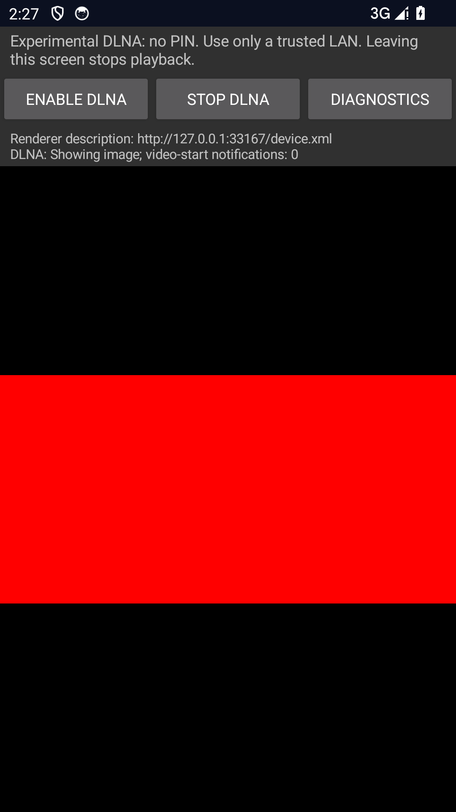

# Android DLNA still images — 2026-10-15

Evidence for [ADR 0133](../../adr/0133-android-dlna-images.md), not a physical-device,
third-party-controller, certification or M3 completion claim. No owner's device
was connected or controlled. All fixtures are generated original test content.

## Local checks

- Rust workspace: 284 passing tests, including 43 FFI and 95 DLNA cases; the
  operator-authorized physical multicast test remains ignored. New tests cover
  typed image preparation, byte limits, shared Session controls, source revocation
  and timeless feedback; a real TCP request checks advertised image MIME types.
- Workspace fmt, all-target/all-feature Clippy and rustdoc with warnings denied pass.
- Receiver/Sender JVM reports: 99 + 11 passing cases; Receiver debug lint passes.
- All 23 Python policy/release/independent-XML tests pass.
- Normal ARM64 JNI builds without probe features, SHA-256:
  `10ec443ec336a5229b1917d78a46d1efc2f756d8cc2dc02e7a6d9a6d02c9f342`.
- Matching probe x86_64 JNI SHA-256:
  `ea0fddcd740382e9dfe2ec7b536d47cdd82c603884c9d350aaa89b5d8fead902`.
- Fresh notice generation verifies 124 components and 257 original legal texts
  against both Android runtime inventories; no dependency changed.

The first workspace run hit the existing unrelated
`mirror_rtsp_runtime_is_time_and_request_bounded` response assertion on Windows.
Its unchanged focused rerun and 40 consecutive repetitions passed, followed by
full workspace passes. This is an unresolved intermittent RTSP follow-up, not an
image fix or a claim that rerunning repaired it; no assertion/timeout was relaxed.

## Isolated Android execution

Agent-owned API 34 x86_64 AVD `frameark_proof_ui`, serial `emulator-5582`, Windows,
Java 21 and NDK 28.0.12433566. Verified exact AVD, completed boot and 10.0.2.15
interface before tests; stopped only that AVD afterward. These probe APKs are not
owner-distribution APKs. Run `dev.frameark.receiver.DlnaPlaybackTest` using the
platform InstrumentationTestRunner as described in the [guide](../../testing/ANDROID_DLNA_PLAYBACK.md).

Three consecutive final full-suite runs passed six cases each in 12.550, 12.689
and 12.680 seconds:

1. Byte-source bounds, 64 KiB read cap, short reads, EOF and idempotent close.
2. Normal private-IPv4 foreground service startup and page-close teardown.
3. Stale/closed display rejection and old-token retirement preserving a newer image.
4. JPEG EXIF 1–8 with four quadrant pixel checks; 4000x3000 downsampling to
   2000x1500; mismatched MIME, bad/truncated/oversized source and cancellation.
5. Real screenshot PNG/JPEG pixels via Rust HTTP Range; Pause, Stop/black, replay,
   zero position/duration, zero/positive seek, volume, three JPEG/PNG replacement
   cycles, malformed-image ERROR_OCCURRED and clearing. Each run used 16 ranges.
6. Existing H.264 MP4 decoded pixels/controls, added video→PNG→video switch, then
   PCM WAV replacement/progress/EOS; 17 ranges and two video-start notifications.

The expanded suite initially exposed old Activity teardown clearing the next
Activity's surface. Resource identity checks now prevent the obsolete page from
clearing the new surface or stopping its service. The earlier two failed cases are
not counted among the three final passes. A shell summary wrapper also initially
misclassified an already-passing six-test output because it matched an array rather
than joined text; the raw 12.689-second run above was successful.

The unedited screenshot was pulled from the owned test app and visually inspected:
red 2:1 fixture, black letterboxing, no clipping of controls or status. It contains
only synthetic content and a loopback endpoint, no personal media. SHA-256:
`c7c2b6ae4cbf1626e320af7fab1c2a991a3098faa800f4d08a979daf61566446`.
Pixel assertions cover the active output; counters are not a frame-count or audio
quality measurement. No long-run memory/latency or physical-display promise follows.

## Remaining gates

Subtitles/playlists, broader authorized origins and Android TLS, MP3/codec variants,
SSDP timing/interface compatibility, named Android/iOS/desktop controllers and the
two-hour playback/Seek gate remain open. PNG EXIF, animation and HDR/wide-gamut
fidelity are unsupported. Production signing still requires owner approval and
protected environment secrets; no production key, tag or release was created.
