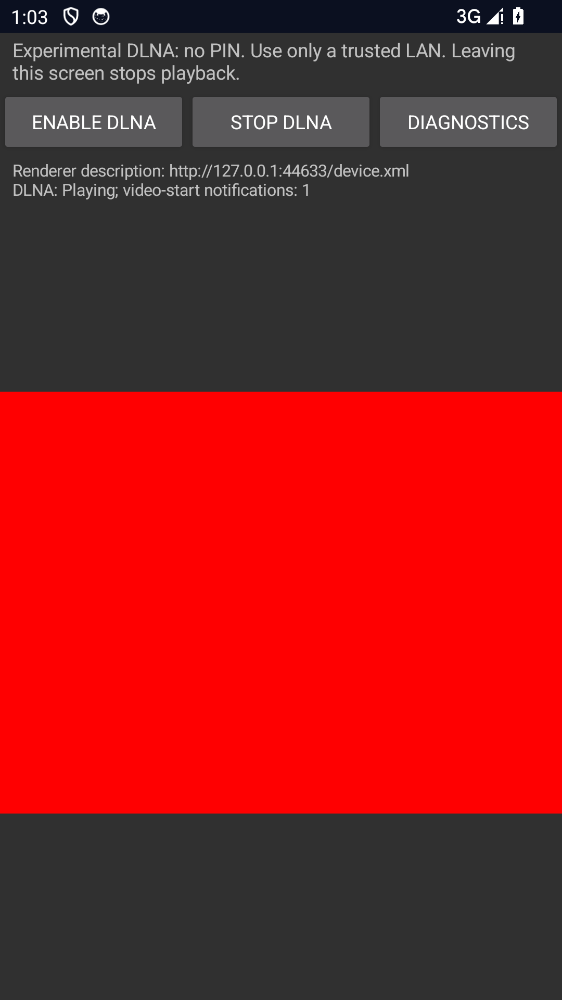

# Android DLNA vertical playback evidence — 2026-10-15

Scope: opt-in Experimental Android DLNA player, not completed M3 or a named
controller matrix. Only the agent-owned `frameark_proof_ui` API 34 x86_64 AVD,
isolated port 5582, was operated. No owner's emulator/phone/TV was accessed.
Probe APKs/native library are instrumentation-only, not delivery artifacts.

## Observed results

`DlnaPlaybackTest` passed all three cases in **three consecutive final runs**:

- Byte adapter: short reads, offset copy, 64 KiB cap, EOF/zero read, invalid/overflow
  bounds and idempotent close.
- Normal private-IPv4 foreground service: listener and OS output start, then leaving
  the page completes Rust worker joins, removes the bridge and releases OS output.
  This tests the service lifecycle, not multicast discovery by another device.
- Actual playback: original synthetic 160x120 H.264 MP4 is created with platform
  encoder/muxer, served over real HTTP Range, read by Rust and passed through JNI
  MediaDataSource to MediaPlayer. The test asserts red **decoded TextureView pixels**,
  advancing position, Pause, Seek to 3 seconds, volume 27, Stop and replay. Replacing
  the source with original 48 kHz mono PCM WAV gives advancing position and EOS.
  Each final run observed 12 origin Range requests and one video-start notification;
  these counts are not frame counts or proof of audible quality.

The test also verifies that Native startup fails while DLNA owns the receiver,
wrong runtime tokens cannot poll commands, shutdown removes the bridge/listener
and the OS player completes release. Network fixtures never use external media.

Screenshot SHA-256:
`3792f861d1264dfa32c3e4699a28d8f0ea112bea9bd10777d3b8c061929731dd`

## Host verification and fixes found during testing

- Full Rust workspace: 270 passed, one existing operator-authorized physical-LAN
  integration test ignored. DLNA: 83 passed; FFI: 41 passed.
- Cancellation source fixture completed 100 consecutive repetitions after replacing
  retryable `Interrupted` with terminal `ConnectionAborted`. The former could spin
  inside `write_all` when close raced a successful write. A direct error-kind guard
  prevents regression. Peer-side EOF/reset are both valid cancellation outcomes.
- A split-request scheduler-edge regression ensures a newly accepted client gets
  the configured total request timeout, not an arbitrarily tiny polling remainder.
- Existing colon-separated identity fingerprint integration is covered after the
  first Android startup test exposed an incorrect hexadecimal-only assumption.
- Rust tests cover exact pinned ranges, TLS roots/SNI, changed-source rejection,
  slow-trickle deadlines, cancellation, feedback/EOS/failure, token/ACK isolation,
  callback peer/scheme rejection, actual host initial NOTIFY and teardown.
- Workspace fmt, Clippy with warnings denied and rustdoc with warnings denied pass.
- Receiver/Sender JVM suites: 107 passed, zero failures/errors; Receiver debug lint
  and matching x86_64 app/instrumentation assembly pass. Repository/Python policy
  checks accompany the commit.
- Existing Native playback regression also passed after the DLNA runs: 90 rendered
  H.264 frames and 138 completed PCM buffers through real loopback QUIC. This checks
  that the new mutually exclusive mode does not break the Native output path.

## Reproduction and boundaries

Follow [the developer test guide](../../testing/ANDROID_DLNA_PLAYBACK.md). Build matching
probe-feature JNI and x86_64 app/test APKs, select only an authorized isolated serial,
then run `dev.frameark.receiver.DlnaPlaybackTest`. Regular builds omit the probe
entry point and permit only explicitly selected private IPv4 listeners.

Not verified: MP3 playback, physical decoders/audio quality/lip sync, other MP4/WAV
codec variants, rotation/device removal, named Android/iOS/desktop controllers,
two-hour playback/Seek, multicast interop across routers/interfaces, or throughput/
memory/latency performance. Complete service schemas, images/subtitles, playlists,
third-party media-origin approval and Android HTTPS remain implementation work.
No production signing, Apple-device evidence, DRM bypass or certification is implied.
