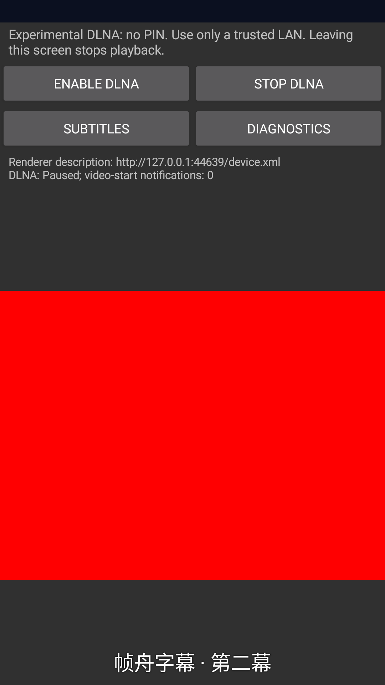

# Android DLNA sidecar subtitles — 2026-10-17

Evidence for [ADR 0135](../../adr/0135-android-dlna-subtitles.md), not M3 completion,
physical-device synchronization, a named-controller matrix or certification.
Only the agent-owned API 34 x86_64 AVD `frameark_proof_ui`, serial
`emulator-5582`, was operated. No owner's device/emulator was accessed.

## Local verification

- Rust workspace, all features: 305 passing tests; one opt-in physical multicast
  test remains ignored. Includes 101 DLNA, 43 FFI and eight media tests.
- New parser cases cover Unicode/BOM/line endings, cue IDs, overlap/adjacency,
  backward seek, malformed encodings/times, unsupported layout, byte/cue/display
  limits (including the exact 10,000-cue boundary) and arbitrary-byte smoke inputs.
- DIDL tests cover namespaces, direct resources and bound ContentDirectory:4
  Caption components, comments/entities, unknown extensions, duplicate/invalid
  resources, DTD, lexical depth, node and byte budgets.
- Absolute-deadline tests cover cached/new reads, expired opens, a stalled initial
  probe and a stalled later response. Neither phase renews the supplied budget.
- Workspace fmt, all-target/all-feature Clippy and rustdoc with warnings denied pass.
- Receiver/Sender JVM: 99 + 11 passing cases. Receiver lint: zero errors, 15 warnings;
  warnings are not represented as a warning-free build.
- All 23 Python tests and repository/file/link policy pass.
- Normal ARM64 JNI without probe features:
  `83d931eb7044c280d3cb5347a9bf6b8185da1c045eac283426006e0149f736bf`.
- Probe x86_64 JNI:
  `226b63785acbdab3a7021e0c23eed74b8b71a5366c77a9f06156a1fa22f5f3ec`.
- Normal Receiver/Sender APK native-package checks pass; normal ARM64 JNI has no
  `startProbe` symbol. Fresh notice generation verifies 124 components and 257
  original legal texts against both runtime inventories; no dependency was added.

## Real Android output

Boot completion and the owned emulator's private IPv4 interface (10.0.2.15) were
verified. Fixtures generate original synthetic H.264 MP4, PCM WAV, JPEG/PNG and
UTF-8 SRT/WebVTT locally. No external media or user content was fetched.

Final `DlnaPlaybackTest` runs: **nine cases, three consecutive passes** in
41.088, 41.237 and 47.638 seconds. Existing byte-adapter, normal foreground-service shutdown,
image-owner/decoder/pixel and MP4/WAV output cases remain covered. The three
added cases verify:

1. Real H.264 playback with two Rust-fetched subtitle tracks. Unicode text reaches
   an actual committed hardware-rendered window buffer, copied with PixelCopy and
   checked for glyph pixels. Pause holds; Seek changes cues; the real Subtitles
   menu selects WebVTT; Off/re-enable, Stop/replay, EOS and source replacement work.
   Alternate-peer, malformed, MIME-mismatched and oversized subtitles fail while
   preserving old paused output. Revoked handles cannot query/select old tracks.
2. Stale/closed subtitle posts and old-owner retirement cannot replace or clear
   current text. All changes happen on the main thread.
3. The test HTTP origin survives EOF before a request and midway through headers,
   then serves a complete Range request. Cancelled requests do not count as reads.

Unedited PixelCopy window capture, visually inspected for the Chinese second cue
and unclipped two-row controls. SHA-256: `4922ac36a4221b9f2dbe933d0c085e48bd936af10ce013e0b32366fc6acb086e`.
It contains only original synthetic content and a loopback endpoint. A submitted
UI buffer is not a physical panel presentation/sync or latency measurement.

## Failures found and corrected before final passes

- Cold-boot System UI ANR dialog dimmed the initial screenshot, failing the glyph
  assertion. The exact owned emulator's dialog was cleared and network/boot
  readiness checked; the pixel threshold was not relaxed.
- Repetition exposed the fixture origin throwing on an empty connection during
  source revocation. EOF handling and a deterministic cancellation regression
  correct the fixture; invalid complete requests still fail assertions.
- Visual review caught a stale compositor screenshot showing the preceding English
  cue despite current TextView state being Chinese. Evidence capture now waits for
  a hardware frame-commit callback and uses PixelCopy, as described by the
  [Android API](https://developer.android.com/reference/android/view/ViewTreeObserver#registerFrameCommitCallback(java.lang.Runnable)).
  A run was intentionally stopped to replace the insufficient screenshot check.
- Menu accessibility can briefly have no active root during dialog transitions.
  The test now waits within its existing bounded polling window for the real menu
  item and successful click; it still checks the selected WebVTT output.

The earlier failed, aborted and superseded runs are not counted as final passes.

## Additional Native playback checks — unresolved

The broader `NativePlaybackTest` did **not** pass consistently. Two initial
subtitle-branch runs failed (audio progress and `playback.queue_unavailable`).
A fresh build of exact main `0b99babb17120fee92a953b00bf4a2c648dec279`, including
its own probe JNI and test APK, was then installed on the same owned emulator:
three passes (5.566, 5.756, 6.189 seconds), followed by a queue-unavailable failure
(37 submitted / 35 rendered video frames, 46 PCM buffers). Reinstalling the
subtitle-branch APKs produced an audio-decoder backpressure failure, one pass
(5.762 seconds), then a listener-release assertion failure.

These are comparison results, not a pass obtained by retrying. The baseline
reproduces queue unavailability without this feature; it does not prove that all
three failure modes have the same cause or rule out every interaction. Native
decoder, playback pump and queue implementation files are unchanged in this
increment. A temporary assertion-only diagnostic was reverted; no timeout,
frame-count or audio-progress assertion was relaxed. Codec backpressure and
consumer scheduling are investigation leads, not a confirmed root cause.

Native playback stability/teardown remains an open M1/M2 issue requiring a
separate focused fix and regression evidence. This preview is not approved for
stable Native playback or milestone closure; the nine-case DLNA results above
must not be represented as an all-protocol Android pass.

## Boundaries

This closes an initial plain-text sidecar software path only. Embedded/styled
subtitles, vendor extensions, broader approved origins/Android TLS, playlists,
MP3/codec/device coverage, Android/iOS/desktop controller interoperability and
two-hour playback/Seek remain open. API 29+ frame capture is an instrumentation
requirement, not a change to the APK's API 26 minimum. Production signing needs
the protected environment and owner approval; no production key, secret, tag or
GitHub Release was created. Device testing remains owner-operated.
